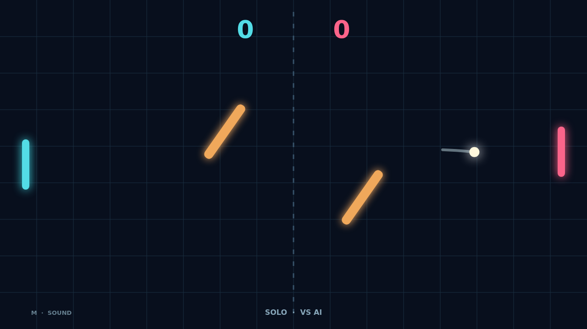

# Carom

Carom turns a familiar paddle rally into a game of angles. Meet each serve with your paddle, send it back across the dark field, and race to 11 points with a two point lead.

Move your paddle as the ball lands to put spin on the return. The flight bends after contact, giving you room to draw a shot away from your rival or recover a difficult rally.

Two swaying, rotating bars divide the field. A shot that looks direct can glance off one and escape at a new angle. Read their motion, find a bank shot, and keep the point alive.

Play Solo against a quick defender or share the keyboard in Versus. Every point resets at center, and match point can stretch into a long, tense exchange.

